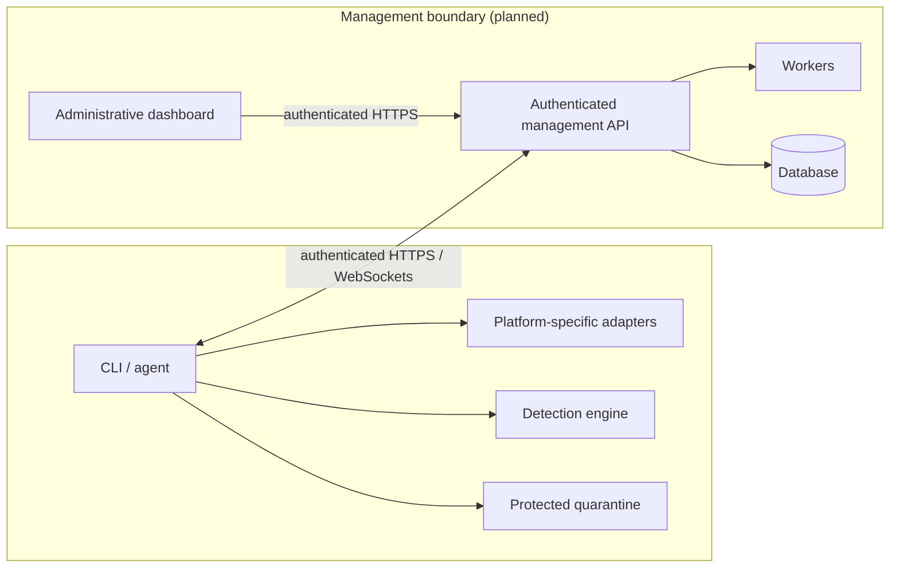

# System architecture

## Status and scope

This document describes a target architecture, not implemented protection.
The current foundation contains only package configuration, a version command
and operating-system identification. Components and connections below are
planned; no management infrastructure is deployed.

## Endpoint agent and detection engine

The agent will orchestrate scans, reports and policy-controlled quarantine.
Shared scanner and detection code must not depend on a particular operating
system. The detection engine will compose independently testable signature,
YARA, heuristic, behavioural and machine-learning components, returning
explainable findings and limitations. Model outputs are not proof of malware.
Streaming, bounded concurrency and cancellation are design requirements.

Windows is the first endpoint target. Interfaces for monitoring, system
information and isolation will separate shared logic from Windows, Linux and
macOS adapters. Unsupported capabilities must be reported explicitly, never
represented as active protection. The present platform identifier identifies
only the host OS; it does not establish a capability.

## Management and dashboard

A future FastAPI management service will authenticate endpoints and
administrators, ingest events, manage scan tasks and distribute verified
updates. PostgreSQL, Celery and Redis are planned, subject to later design and
deployment decisions. The planned React/TypeScript dashboard will use the
API for endpoint inventory, incidents and administrative workflows. Neither
the server nor dashboard exists yet.

## Communication and security boundaries

Future endpoint and dashboard connections require authenticated HTTPS or
WebSockets with certificate validation, scoped authorization, replay
protection and secure credential storage. Treat endpoint data, paths, files and
API input as untrusted. No secrets belong in source control or logs.

Detection must not execute samples. Quarantine requires a separate security
design covering protected storage, symlink and reparse-point handling, race
conditions, integrity, authorization, audit and recovery. No automatic
destructive remediation is present. Privileged monitoring and unprivileged
analysis must be separated and granted only necessary permissions; kernel
components require explicit approval and dedicated review.

## Expansion

The directories reserve boundaries for future work, not interfaces or
production capabilities. The initial version focuses on a standalone scanning
engine, with no management service dependency. Additional platform adapters,
verified updates and enterprise integrations can be added after their
individual designs and acceptance tests.
